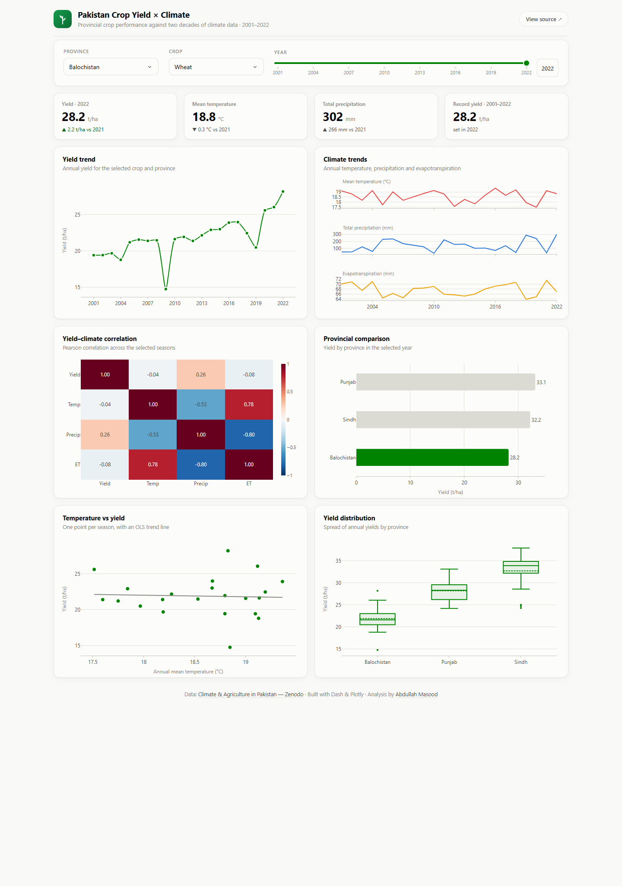
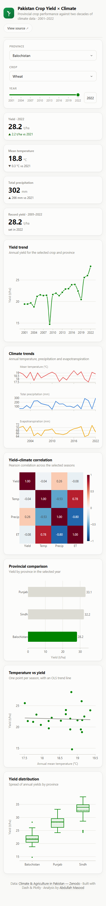

# Pakistan Crop Yield × Climate

**An interactive analytics dashboard exploring how two decades of climate data relate to crop yields across the provinces of Pakistan (2001–2022).**

[](https://pakistan-crop-yield-vs-climate.onrender.com)
[](https://www.python.org/)
[](https://dash.plotly.com/)
[](LICENSE)



## Live demo

The dashboard is deployed on Render:
**[pakistan-crop-yield-vs-climate.onrender.com](https://pakistan-crop-yield-vs-climate.onrender.com)**

> The free tier sleeps when idle — the first load may take up to a minute.

## What it shows

Pakistan's economy leans heavily on agriculture, which makes it unusually exposed to a changing climate. This project pairs 22 years of provincial crop statistics with monthly climate records and lets you explore the relationship interactively:

| View | Description |
|---|---|
| **KPI tiles** | Yield, mean temperature, total precipitation and the all-time record for the current selection, with year-over-year deltas |
| **Yield trend** | Annual yield for the selected crop and province |
| **Climate trends** | Temperature, precipitation and evapotranspiration as small multiples (no dual axes) |
| **Yield–climate correlation** | Pearson correlation matrix computed across the selected seasons |
| **Provincial comparison** | Yield by province for the selected year, with the active province highlighted |
| **Temperature vs yield** | One point per season with an OLS trend line |
| **Yield distribution** | Box plots of annual yields by province |

Everything is driven by three controls — province, crop, and a year slider — in a single filter row that scopes every chart. The layout is fully responsive down to phone widths.

<p align="center">
  
</p>

## Methodology

- The source dataset is **monthly** (12 rows per year, province and crop). All analytical views first aggregate it to **annual** values: mean temperature, total precipitation, total evapotranspiration — so trends and correlations are computed on one observation per season, never on repeated monthly rows.
- Correlations are computed **across seasons** (up to the selected year) rather than within a single year, where yield is constant by construction.
- The temperature–yield scatter fits an ordinary-least-squares trend line (via `statsmodels`) when at least three seasons are selected.
- The companion notebook (`pakistan-crop-yield-vs-climate.ipynb`) covers the full pipeline: cleaning and merging the raw Zenodo sheets, EDA, and a scikit-learn regression that predicts yield from climate variables (R² ≈ 0.95 on the held-out set).

### Selected findings

- Wheat yields improved gradually across all provinces over the period.
- Higher mean temperatures correlate negatively with yields for Punjab wheat and cotton, and for heat-sensitive fruit crops in Sindh (mango, banana).
- Better rainfall years lifted tomato and onion yields in Balochistan.
- Evapotranspiration is frequently negatively correlated with yield in drought years.

## Dataset

[Climate & Agriculture in Pakistan — Zenodo](https://zenodo.org/records/15486470)

- **Climate:** min/max/mean temperature, precipitation, wind speed, solar radiation, evapotranspiration
- **Agriculture:** crop-wise area, production and yield for Punjab, Sindh and Balochistan

The cleaned, merged dataset ships with the repository as `merged_agri_climate_data.csv`.

## Project structure

```
pakistan-crop-yield-vs-climate/
├── climate_dashboard.py                  # Dash app — data prep, figures, layout, callbacks
├── merged_agri_climate_data.csv          # Cleaned monthly agri-climate dataset (2001–2022)
├── pakistan-crop-yield-vs-climate.ipynb  # Analysis notebook — cleaning, EDA, modelling
├── requirements.txt
├── Procfile                              # Production entry point (gunicorn)
├── assets/
│   ├── style.css                         # Dashboard theme (design tokens, cards, responsive grid)
│   ├── logo.svg
│   └── dashboard-*.png                   # Screenshots
├── LICENSE
└── README.md
```

## Running locally

With [uv](https://docs.astral.sh/uv/) (recommended):

```bash
git clone https://github.com/Abdullah-Masood-05/pakistan-crop-yield-vs-climate.git
cd pakistan-crop-yield-vs-climate

uv venv
uv pip install -r requirements.txt
uv run python climate_dashboard.py
```

Or with plain pip:

```bash
python -m venv .venv
.venv\Scripts\activate          # Windows  (macOS/Linux: source .venv/bin/activate)
pip install -r requirements.txt
python climate_dashboard.py
```

Then open <http://127.0.0.1:8050>.

## Deployment

The app exposes a WSGI server as `climate_dashboard:server`, so any WSGI host works:

```bash
gunicorn climate_dashboard:server
```

The included `Procfile` makes it deployable to Render (or Heroku-compatible platforms) as-is.

## Tech stack

Python · pandas · Plotly · Dash · statsmodels · scikit-learn (notebook) · gunicorn

## Contributing

Issues and pull requests are welcome — if you have an idea for a new view, a data improvement, or a fix, open one.

## License

Released under the [MIT License](LICENSE).

## Author

**Abdullah Masood**
[LinkedIn](https://www.linkedin.com/in/abdullah-masood-921458221/) · [GitHub](https://github.com/Abdullah-Masood-05)

Thanks to [Zenodo](https://zenodo.org) for hosting the open dataset, and to the open-source Python community.
